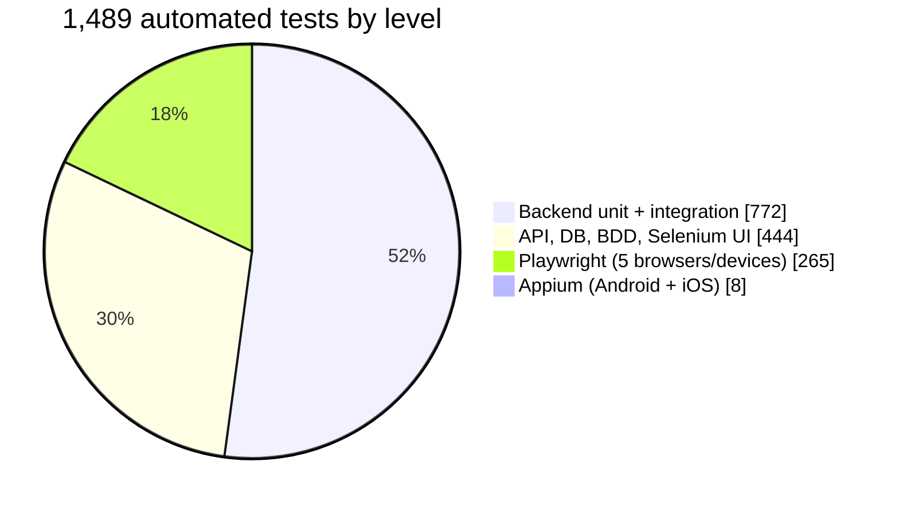
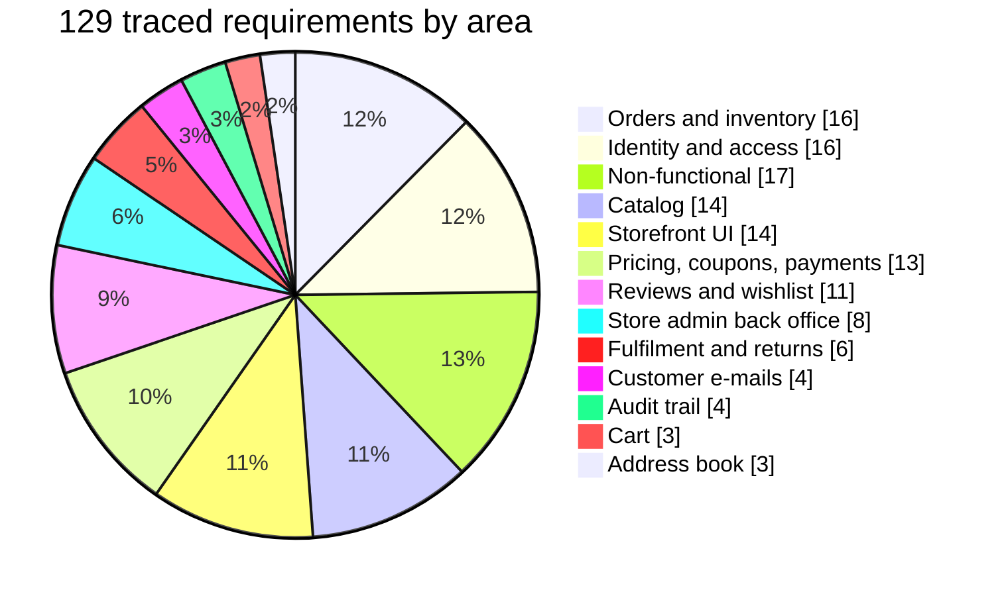
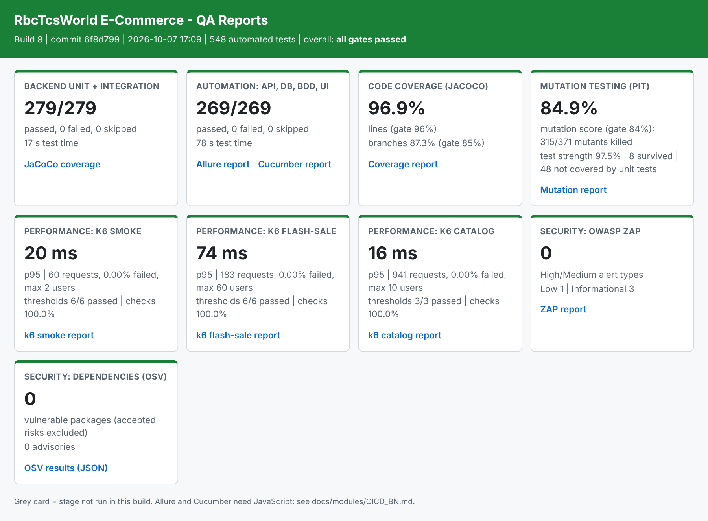
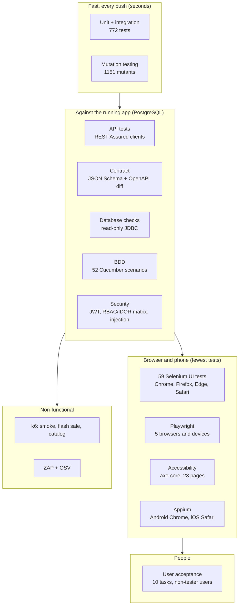
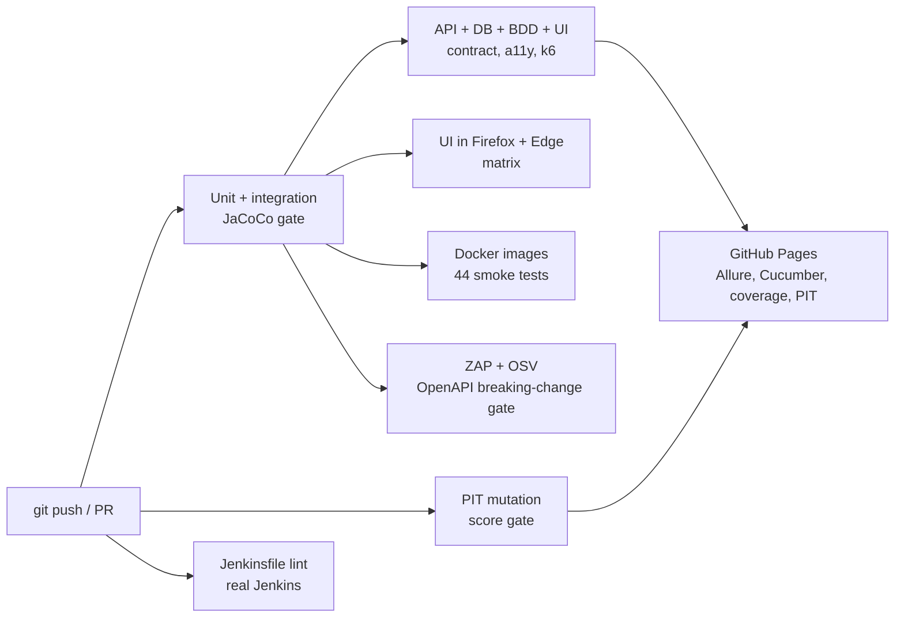

# RbcTcsWorld E-Commerce Suite

[](https://github.com/rbchy/RbcTcsWorld_ECommerceSuite/actions/workflows/ci.yml)


[](https://rbchy.github.io/RbcTcsWorld_ECommerceSuite/coverage/)
[](https://rbchy.github.io/RbcTcsWorld_ECommerceSuite/mutation/)
[](https://rbchy.github.io/RbcTcsWorld_ECommerceSuite/)

An Amazon-inspired online store (catalog, cart, checkout with a delivery address, Stripe or mock payment, shipping,
returns, reviews, wishlist, order e-mails, password reset by e-mail, guest checkout and an address book, size/colour variants, a faceted filter panel, flash deals with a countdown, "customers also bought", invoice PDFs, optional two-factor sign-in by e-mailed code, a saved-card wallet (tokens only), a store back office with customers, coupons,
multi-warehouse inventory, reports, a payment ledger and advanced search, and an append-only audit trail inspired by 21 CFR Part 11 / ALCOA+)
that I built **to be tested**: the application is the test object, and the real work is the test system around it.
Every push goes through 18 quality gates in GitHub Actions; the same pipeline runs in Jenkins on a Mac.
The public demo runs on one free cloud server with HTTPS ([deploy/](deploy/), guide: [ORACLE_CLOUD_BN](docs/deploy/ORACLE_CLOUD_BN.md)).

Author: **RB Chowdhury**, QA Automation Engineer / SDET - [GitHub](https://github.com/rbchy) · [LinkedIn](https://www.linkedin.com/in/rbchy/)

---

## 🚦 Project Status Board


[](https://github.com/rbchy/RbcTcsWorld_ECommerceSuite/actions/workflows/ci.yml)


The board shows the GitHub Actions run of `main` on 23 Oct 2026 (commit `f1a74ed`). The CI badge above is live;
the board is redrawn after a release with [`docs/images/make_readme_cards.py`](docs/images/make_readme_cards.py).

## 🥧 Breakdown





Every requirement links to its tests in the [traceability matrix](docs/qa/TRACEABILITY_MATRIX.md); CI fails if one has none.

## 📈 GitHub Stats


The badges update live from GitHub; the card above is a snapshot of the same day as the status board.

---

## Reviewing this in 5 minutes

1. **Latest build:** the screenshot below (Jenkins build 54, all gates passed), or the
   [GitHub Actions runs](https://github.com/rbchy/RbcTcsWorld_ECommerceSuite/actions).
2. **Live reports:** [all reports](https://rbchy.github.io/RbcTcsWorld_ECommerceSuite/reports/) · [Allure](https://rbchy.github.io/RbcTcsWorld_ECommerceSuite/) · [Cucumber](https://rbchy.github.io/RbcTcsWorld_ECommerceSuite/cucumber/) ·
   [JaCoCo coverage](https://rbchy.github.io/RbcTcsWorld_ECommerceSuite/coverage/) ·
   [PIT mutation](https://rbchy.github.io/RbcTcsWorld_ECommerceSuite/mutation/) ·
   [Playwright](https://rbchy.github.io/RbcTcsWorld_ECommerceSuite/playwright/)
3. **Defects the tests actually found:** [Defect Reports](docs/qa/DEFECT_REPORTS.md) - 29 entries, each with
   evidence, root cause, fix and regression test.
4. **How release decisions are made:** [Test Strategy](docs/qa/TEST_STRATEGY.md) ·
   [Risk Register](docs/qa/RISK_REGISTER.md) · [Test Summary Report (GO / NO-GO)](docs/qa/TEST_SUMMARY_REPORT.md)
   · [UAT Plan](docs/qa/UAT_PLAN.md) (10 tasks for non-tester users, each traced to its requirements)
5. **Code to read first:** the [pipeline](.github/workflows/ci.yml), the
   [flash-sale concurrency test](automation/src/test/java/com/rbctcsworld/ecommerce/qa/tests/api/InventoryConcurrencyTest.java),
   the [API contract test](automation/src/test/java/com/rbctcsworld/ecommerce/qa/tests/api/ApiContractTest.java) and the
   [access-control matrix](automation/src/test/java/com/rbctcsworld/ecommerce/qa/tests/security/AccessControlMatrixTest.java).
6. **Why it is built this way:** [Architecture Decision Records](docs/adr/) - nine short records, each with the alternatives
   and the price paid. Commands: `make help` · [Contributing](CONTRIBUTING.md) · [MIT License](LICENSE)


*One page per Jenkins build with every gate, generated by [`ci/qa_dashboard.py`](ci/qa_dashboard.py).*

---

## Quality gates

A gate fails the build. Nothing is "reported only" unless the table says so.

| # | Gate | Threshold | Current | Tool |
|---|---|---|---|---|
| 1 | Backend unit + integration | 100 % pass | 772 / 772 | JUnit 5, Mockito, H2 + Flyway |
| 2 | API, database, BDD, UI | 100 % pass | 444 / 444 | REST Assured, JDBC, Cucumber 7, Selenium 4, Mailpit |
| 3 | Line / branch coverage | >= 97 % / >= 88 % | 97.3 % / 94.2 % | JaCoCo |
| 4 | Mutation score | >= 84 % | 89.3 % (test strength 94.7 %) | PIT |
| 5 | API contract, consumer side | every response matches its schema | 12 strict JSON Schemas | json-schema-validator |
| 6 | API contract, provider side | no breaking change vs. approved baseline | 0 (gate has its own self-test) | openapi-diff |
| 7 | Accessibility | 0 serious / critical | 0 on 23 pages | axe-core, WCAG 2.1 A + AA |
| 8 | Cross-browser | 100 % pass | 59 / 59 in Firefox and Edge | Selenium, CI matrix |
| 9 | Performance | SLO thresholds (p95, error rate, no overselling) | p95 16-72 ms, 0 % errors; JMeter 100 users p95 77 ms | k6, JMeter (manual workflow) |
| 10 | DAST | 0 Medium / High | 0 | OWASP ZAP API scan |
| 11 | Dependencies | 0 known vulnerabilities, 0 open exceptions | 0 (complete SBOMs, self-test passed) | OSV-Scanner on CycloneDX SBOMs |
| 12 | Containers | stack healthy, smoke tests pass | 63 / 63 | Docker Compose |
| 13 | Traceability | every requirement has a test | 129 / 129 | `docs/qa/check_rtm.py` |
| 14 | Pipeline definition | Jenkinsfile valid | validated by a real Jenkins | declarative linter |
| 15 | Public demo stack | HTTPS, only 80/443 open, demo safeguards, nightly reset | 15 / 15 smoke checks | Docker Compose, Caddy, `deploy/smoke.sh` (GitHub Actions only: needs ports 80/443) |
| 16 | Playwright (TypeScript) | 100 % pass, visual baselines match | 262 / 262 + 3 skipped by design (Chromium, Firefox, WebKit, Pixel 7, iPhone 14) | Playwright, axe-core |
| 17 | Phone: Android | 100 % pass (one rerun, reported as flaky) | 4 / 4 in Chrome on Android 14 | Appium 3 + UiAutomator2, Android emulator |
| 18 | Phone: iOS | 100 % pass (one rerun, reported as flaky) | 4 / 4 in Safari on the newest iPhone simulator | Appium 3 + XCUITest, macOS runner |

Thresholds are set just under the measured value on purpose: they stop regressions without inviting
tests that exist only to move a number.

---

## Test architecture



Design choices behind it:

- **The pyramid is real, not drawn.** Business rules (prices, tax, coupons, order state machine, return
  window) are tested at the unit level; the browser tests only check what a customer sees. Preconditions
  for UI tests (a paid order, a delivered order, a wishlist) are created through the API, so a UI test
  never clicks through five pages to reach the one it is testing.
- **Mutation testing over coverage.** Coverage was 96 % when PIT showed that "a paid order cannot be paid
  again" passed even with the charge happening (`anyLong()` does not match `null`, DEF-013).
  Coverage says the code ran; mutation testing says a test would notice if it were wrong.
- **Contracts from both sides.** Consumer schemas use `additionalProperties: false`, so a leaked field
  (customer e-mail in public tracking, a full card number) fails a test. The provider side diffs the live
  OpenAPI document against an approved baseline; changing the contract is a deliberate, reviewed step.
- **Concurrency is tested, not assumed.** 300 buyers race for 50 units; exactly 50 orders succeed and
  stock ends at 0 (atomic conditional `UPDATE` plus a CHECK constraint). k6 repeats this in every build.
- **Stable locators and waits.** `data-testid` attributes only, explicit waits only, no `Thread.sleep`.
  A flaky test is treated as a defect and gets a report (DEF-008 to DEF-010, DEF-019).
- **Risk drives scope.** Each requirement is linked to a risk and a test in the
  [traceability matrix](docs/qa/TRACEABILITY_MATRIX.md); CI fails if a requirement loses its last test.

---

## Pipeline



The same stages run in a [Jenkinsfile](Jenkinsfile) with parameters (`BROWSER`, `RUN_UI`, `RUN_MUTATION`,
`RUN_SECURITY`). GitHub jobs are pinned to `ubuntu-24.04`; a weekly [runner canary](.github/workflows/runner-canary.yml)
runs the same pipeline on the next image first. Browser tests get one rerun, and a pass on the rerun is reported
as FLAKY with a count instead of disappearing. Two CI systems on two CPU architectures (Linux x86 and macOS ARM) have already paid for
themselves: four defects appeared on only one of them (DEF-014, DEF-015, DEF-019, DEF-020).

---

## What the tests found

All entries are in [Defect Reports](docs/qa/DEFECT_REPORTS.md). A selection:

| ID | Found by | Defect | Outcome |
|---|---|---|---|
| DEF-003 / 004 | Attack tests | No brute-force lockout; login timing revealed which e-mails exist | Lockout + constant-time login |
| DEF-005 | OSV scan | 21 vulnerable libraries | 0, with a CVE gate in CI |
| DEF-007 | k6 report | Catalog returned every product in one response | Pagination, response -91 %, p95 22 -> 9 ms |
| DEF-013 | PIT | A test that could never fail | Fixed + 30 targeted tests, score 65.5 -> 84.9 % |
| DEF-016 | Selenium | Fast typing showed results of an older search | Request guard + debounce |
| DEF-017 | ZAP + API test | `?=x` query string returned 500 | 400, regression test with a raw HTTP client |
| DEF-018 | axe-core (written first) | All 8 pages failed WCAG 2.1 AA (contrast, labels, page language) | 0 serious / critical |
| DEF-020 | Jenkins on macOS | Edge / Firefox drivers could not be downloaded | Selenium 4.25 -> 4.49 |
| DEF-021 | Runner canary | The dependency scan itself went blind on a rate limit and missed a CVSS 9.1 library | SBOM-based scan with completeness check and self-test |

Two critical Spring CVEs had no patch for Spring Boot 3.5. They were accepted for a limited time (reason,
expiry date, guard test) and then removed by upgrading to Spring Boot 4.1 on a branch. The gates caught
three regressions before the merge (a new Tomcat CVE, DEF-016, DEF-017).

---

## Known limitations

Stating these is part of the test report, not a footnote.

- **Payments run on the mock gateway by default.** Stripe (`PAYMENT_PROVIDER=stripe`) is contract-tested
  against stripe-mock on every build; real test-mode runs need a `STRIPE_TEST_SECRET_KEY` secret. The card
  form is the shop's own (a production shop would use Stripe Elements), and there are no Stripe webhooks yet.
- **Order e-mails are English plain text** and the SMTP channel has no authentication or TLS yet (enough
  for Mailpit; a real mail service needs both).
- **Tokens live in the browser's localStorage.** An XSS bug could read them; the strict CSP and React's
  escaping reduce that risk. HttpOnly cookies would remove it but bring CSRF handling with them.
- **A logged-out access token stays valid until it expires** (at most 15 minutes). The refresh token is
  revoked at once; a denylist for access tokens was judged not worth a database call on every request.
- **Automated accessibility rules find part of the problems.** Keyboard-only, screen-reader and zoom
  checks are manual items on the release checklist.
- **Safari runs only on a Mac** (Jenkins `BROWSER=safari`, no headless mode). Phones are an Android emulator and an
  iOS simulator in CI (Appium), not physical devices; the guide shows how to plug in a real phone.
- **k6 numbers come from CI runners** and are for comparison between builds, not capacity planning.

---

## Stack

| Layer | Technology |
|---|---|
| Backend | Java 21, Spring Boot 4.1 (Spring 7, Jackson 3, Tomcat 11), Spring Security + JWT, PostgreSQL 16, Flyway |
| Storefront | React + Vite |
| Test automation | JUnit 5, REST Assured, Selenium 4 (Page Objects), Cucumber 7 + PicoContainer, axe-core, JDBC |
| Test quality | JaCoCo, PIT |
| Non-functional | k6, OWASP ZAP, OSV-Scanner, openapi-diff |
| Reporting | Allure (trend history, HTTP attachments, failure categories), Cucumber HTML, per-build QA dashboard |
| Delivery | Docker (multi-stage, non-root), Docker Compose, GitHub Actions, Jenkins |

---

## Run it

**Whole application, one command** (PostgreSQL + Redis + Mailpit + backend + storefront):

```bash
docker compose --profile app up -d --build        # storefront http://localhost:5173, API http://localhost:8081
docker compose --profile app down                 # add -v to delete the database
```

Or double-click the launcher in `desktop/` (Mac `.command`, Windows `.bat`, Linux `.sh`); it starts Docker if needed
and opens the store. In Chrome or Edge, **Install app** in the top bar adds it as a desktop app.

**Development** (backend from Eclipse or Maven, live-reloading UI):

```bash
docker compose up -d                              # PostgreSQL only
cd backend && mvn spring-boot:run                 # API on 8081; Flyway creates tables and demo data
cd frontend && npm install && npm run dev         # UI on 5173
```

| | |
|---|---|
| Backend API | http://localhost:8081 (8080 stays free for Jenkins) · OpenAPI description at `/v3/api-docs` |
| PostgreSQL | localhost:5432, database / user / password `ecommerce` |
| Admin (dev only) | `admin@rbctcsworld.com` / `Admin@12345`, override with `ADMIN_EMAIL`, `ADMIN_PASSWORD` |
| Coupons | `WELCOME10`, `SAVE5`, `EXPIRED20`, `FUTURE15`, `DISABLED` |
| Test cards | `4242424242424242` approved · `4000000000000002` declined · `4000000000009995` insufficient funds |

## Run the tests

`mvn test` in the root folder runs the backend tests only. The automation suite needs the backend on 8081
(and the storefront on 5173 for `ui` and `a11y`).

```bash
mvn -f backend/pom.xml verify                                   # unit + integration + coverage gate
mvn -f backend/pom.xml -Pmutation -Djacoco.skip=true test-compile org.pitest:pitest-maven:mutationCoverage   # PIT
mvn -f automation/pom.xml clean test -DexcludedGroups=ui,mobile        # API, contract, DB, BDD, security
mvn -f automation/pom.xml clean test -Dgroups=ui                # UI + accessibility, headless Chrome
mvn -f automation/pom.xml clean test -Dgroups=ui -Dbrowser=edge # chrome | firefox | edge | safari
mvn -f automation/pom.xml clean test -Dcucumber.filter.tags="@flagship"   # register-to-refund journey
mvn -f automation/pom.xml allure:serve                          # open the Allure report
```

Other tags: `contract`, `a11y`, `db`, `security`, `concurrency`, `payment`, `returns`, `notification`.
E-mails the shop sends land in Mailpit: http://localhost:8025.
k6 scripts and how to run them: [performance](docs/modules/PERFORMANCE_K6_BN.md).

---

## Repository layout

```text
backend/        Spring Boot API, unit + integration tests, PIT profile
frontend/       React storefront + store-admin panel, 6 languages, installable PWA (data-testid everywhere)
desktop/        One-click launchers for Mac, Windows and Linux
automation/     API clients, Page Objects, Cucumber features, contract schemas, test data fixtures
performance/    k6 scripts with SLO thresholds
security/       ZAP rules, SBOM + OSV scan with self-test, version check
ci/             QA dashboard generator for Jenkins
docs/qa/        Test strategy, plan, risk register, RTM, defect reports, test summary report
docs/modules/   Module guides (Bangla), one per feature or test layer
```

## Documentation

**QA documents (English):** [Strategy](docs/qa/TEST_STRATEGY.md) · [Plan](docs/qa/TEST_PLAN.md) ·
[Risks](docs/qa/RISK_REGISTER.md) · [Traceability (129 requirements)](docs/qa/TRACEABILITY_MATRIX.md) ·
[Defects (29)](docs/qa/DEFECT_REPORTS.md) · [Test Summary Report](docs/qa/TEST_SUMMARY_REPORT.md) · [UAT Plan](docs/qa/UAT_PLAN.md) · [UAT Summary](docs/qa/UAT_SUMMARY.md)

**Help (Bangla), start here:** [HELP_BN](docs/HELP_BN.md) - running on every device, menus, login, admin, tests, reports, Jenkins, troubleshooting.

**Module guides (Bangla):**

| Area | Guide |
|---|---|
| Foundation, cart, orders + inventory, checkout + payment, fulfilment + returns, reviews + wishlist | [Module 0](docs/modules/MODULE_00_FOUNDATION_BN.md) · [1](docs/modules/MODULE_01_CART_BN.md) · [2](docs/modules/MODULE_02_ORDERS_INVENTORY_BN.md) · [3](docs/modules/MODULE_03_CHECKOUT_PAYMENT_BN.md) · [4](docs/modules/MODULE_04_FULFILLMENT_RETURNS_BN.md) · [5](docs/modules/MODULE_05_REVIEWS_WISHLIST_BN.md) |
| Storefront and UI tests, cross-browser | [FRONTEND_UI_TESTS_BN](docs/modules/FRONTEND_UI_TESTS_BN.md) |
| Menu, store-admin panel, six languages, help, desktop | [STOREFRONT_UI_BN](docs/modules/STOREFRONT_UI_BN.md) |
| Login sessions: refresh tokens, Redis login lockout | [AUTH_SESSIONS_BN](docs/modules/AUTH_SESSIONS_BN.md) |
| Forgot password: reset link by e-mail | [PASSWORD_RESET_BN](docs/modules/PASSWORD_RESET_BN.md) |
| Audit trail (append-only, hash chain; inspired by Part 11 / ALCOA+) | [AUDIT_TRAIL_BN](docs/modules/AUDIT_TRAIL_BN.md) |
| Store admin back office: banner, sub-menus, customers, coupons, reports, payments, advanced search | [ADMIN_BACK_OFFICE_BN](docs/modules/ADMIN_BACK_OFFICE_BN.md) |
| Multi-warehouse inventory: allocation, split shipments, transfers, no overselling | [MULTI_WAREHOUSE_BN](docs/modules/MULTI_WAREHOUSE_BN.md) |
| Delivery address at checkout | [SHIPPING_ADDRESS_BN](docs/modules/SHIPPING_ADDRESS_BN.md) |
| Stripe payments (3 test layers), order e-mails (transactional outbox, Mailpit) | [PAYMENTS_NOTIFICATIONS_BN](docs/modules/PAYMENTS_NOTIFICATIONS_BN.md) |
| API contract and accessibility | [API_CONTRACT_A11Y_BN](docs/modules/API_CONTRACT_A11Y_BN.md) |
| Performance (k6) | [PERFORMANCE_K6_BN](docs/modules/PERFORMANCE_K6_BN.md) |
| Security | [SECURITY_BN](docs/modules/SECURITY_BN.md) |
| Mutation testing | [MUTATION_BN](docs/modules/MUTATION_BN.md) |
| CI/CD, Docker, Jenkins | [CICD_BN](docs/modules/CICD_BN.md) |
| Allure reporting | [ALLURE_REPORT_BN](docs/modules/ALLURE_REPORT_BN.md) |
| Spring Boot 3.5 -> 4.1 upgrade | [SPRING_BOOT_4_BN](docs/modules/SPRING_BOOT_4_BN.md) |
| QA documents explained | [QA_DOCUMENTS_BN](docs/modules/QA_DOCUMENTS_BN.md) |

**Eclipse:** File -> Import -> Maven -> Existing Maven Projects -> select this folder.
After a pull: right-click the project -> Maven -> Update Project.

---

No test suite proves the absence of defects. This one is built to find the expensive ones early,
show the evidence, and make the release decision explicit.
